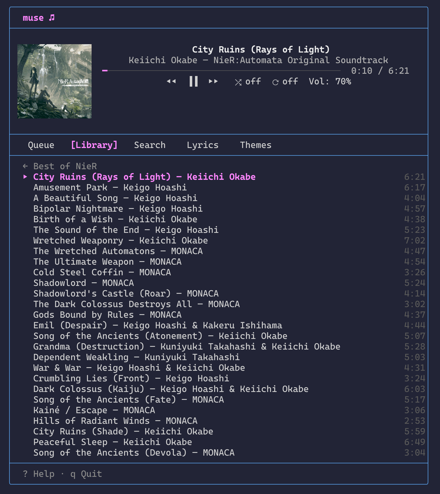

# muse

[](https://www.rust-lang.org/)
[](https://swift.org/)
[](https://www.apple.com/macos/)

A terminal UI for controlling Apple Music and Spotify on macOS.



## Features

- **Dual backend** — Apple Music (via AppleScript) or Spotify (via Web API)
- Full playback control (play/pause, next/previous, volume, shuffle, repeat)
- Browse playlists and search your library
- Favorite tracks and add/remove them from playlists
- Remove individual tracks from the queue
- Jump to the current track's artist or album with a single key
- Open the artist page or full album directly in Music.app or Spotify
- Queue management with auto-advance
- Lyrics display fetched from LRCLIB (with embedded lyrics fallback)
- Album art display via sixel graphics in supported terminals
- Vim-style navigation (j/k, g/G, Ctrl+F/Ctrl+B)
- Customizable color themes (TOML config files, user-extensible)

## Requirements

- **macOS**: Apple Music and/or Spotify. Swift 6.2+ required for Apple Music backend.
- **Linux/Windows**: Spotify only. No additional dependencies.

## Install

```
git clone <repo-url>
cd muse
just install
```

Running `just` without a command lists all available recipes.

On Linux, `cargo build --release` works out of the box — the Apple Music backend is automatically skipped on non-macOS platforms.

### Spotify-Only (explicit, no Xcode needed)

```
cargo build --release --no-default-features --features spotify
```

## Configuration

Config file: `~/.config/muse/config.toml`

```toml
backend = "spotify"              # optional, default is "apple_music"
theme = "~/.config/themes/tokyo-night-moon.toml"
theme_catalog = "~/.config/themes/catalog.toml"
default_tab = "queue"            # tab shown on launch: queue, library, search, lyrics
ui_width = 120                   # max UI width in columns (min 40, or "auto")
show_artwork = true              # display album art (requires sixel/kitty/iTerm2)
image_protocol = "auto"          # auto | kitty | sixel | iterm2 | halfblocks
lyrics_enabled = true            # fetch synced lyrics from LRCLIB

[spotify]
client_id = "YOUR_ID"            # required if backend = "spotify"
```

### Custom Themes

`theme` is loaded directly at startup. `theme_catalog` contains a `themes = [...]` array of explicit file paths used by the picker. Muse never scans a theme directory. Picker changes apply to the current session only and never rewrite `config.toml`; edit `theme` directly to change the startup theme. A theme file can use:

```toml
[colors]
bg = "#1a1a2e"
bg_highlight = "#2a2a4e"
fg = "#e0def4"
fg_bright = "#f0eeff"
fg_dim = "#8888aa"
fg_muted = "#555577"
hot_pink = "#ff2975"
cyan = "#00e5ff"
red = "#ff6b9d"

[ui]
background = "bg"
cursor_bg = "bg_highlight"
border = "fg_muted"
accent = "hot_pink"
selection = "cyan"
key = "cyan"
text = "fg"
text_bright = "fg_bright"
text_dim = "fg_dim"
text_muted = "fg_muted"
heading = "fg_bright"
error = "red"
```

Colors can be 256-color indices (integers) or hex RGB strings (`"#82aaff"`). UI roles may reference named entries in `[colors]` or contain colors directly. Muse uses `background` for the complete frame, `cursor_bg` and `selection` for the focused list row, `key` for keybinding/input markers, `accent` for branding and progress, and `heading` for time/subtitle text.

### Spotify Setup

1. Create an app at [developer.spotify.com/dashboard](https://developer.spotify.com/dashboard)
2. Add `http://localhost:18234/callback` as a redirect URI
3. Add `backend = "spotify"` and `[spotify] client_id = "YOUR_ID"` to your config
4. Run `muse` — it will open your browser for login on first launch

## Usage

Launch `muse` in any terminal. The player panel at the top always shows the current track. Use the tabbed panel below to browse your library, manage the queue, or search.

### Key Bindings

| Key | Action |
|-----|--------|
| `Tab` / `Shift+Tab` | Cycle tabs |
| `l` | Library tab |
| `/` | Search tab |
| `L` | Lyrics tab |
| `space` | Play / Pause |
| `n` | Next track |
| `p` | Previous track |
| `+` / `=` | Volume up |
| `-` | Volume down |
| `s` | Toggle shuffle |
| `r` | Cycle repeat (off → all → one) |
| `f` | Toggle favorite |
| `d` / `x` | Remove track (queue or playlist) |
| `C` | Clear queue |
| `P` | Add to playlist |
| `a` | Search current track's artist |
| `A` | Search current track's album |
| `o` | Open artist in Music.app / Spotify |
| `O` | Open album in Music.app / Spotify |
| `j` / `k` | Navigate list (vim-style) |
| `g` / `G` | Jump to top / bottom |
| `Ctrl+F` / `Ctrl+B` | Page down / up |
| `↑` / `↓` | Navigate list / Scroll lyrics |
| `PgUp` / `PgDn` | Page up / down |
| `Home` / `End` | Jump to top / bottom |
| `Enter` | Play track / playlist |
| Left click | Switch tabs; toggle shuffle/repeat; seek in the progress bar; play list items |
| Mouse wheel | Scroll Queue, Library, Search, and Lyrics under the pointer |
| `→` | Browse playlist tracks (Library) |
| `Q` | Load playlist into queue without playing (Library) |
| `/` | Filter list (queue/library) / Search |
| `Backspace` | Back (library) / Clear (search) |
| `t` | Theme picker |
| `?` | Toggle help overlay |
| `q` | Quit |

### Tabs

- **Queue** — tracks from the last playlist you played. Select a track and press Enter, or left-click it, to jump to it. Tracks auto-advance when the current one finishes. Press `d` to remove a track. Press `/` to filter by name or artist.
- **Library** — browse your playlists. Press Enter or left-click a playlist to start playing it; press `→` to browse its tracks first, or `Q` to load it into the queue without starting playback. Inside a playlist, Enter or left-click plays the selected track. Press `d` to remove a track from the playlist. Backspace goes back to the playlist list. Press `/` to filter playlists or tracks.
- **Search** — type to search your library. Results appear as you type (minimum 2 characters). Enter or left-click plays the selected result.
- **Lyrics** — displays lyrics for the current track. Fetched from [LRCLIB](https://lrclib.net) (falls back to embedded lyrics if available). Scroll with arrow keys. Shows "No lyrics available" when none are found.

Press `t` from any tab to open the theme picker overlay. Navigate with arrow keys, preview live, and press Enter to apply for the current session. Picker entries come only from the configured catalog.

Playback controls (`space`, `n`, `p`, `+`/`-`, `s`, `r`) work from any tab. The Queue/Library/Search/Lyrics tabs, shuffle and repeat indicators, and progress bar are also clickable; clicking the progress bar seeks to that position. In the Search tab or while filtering, letter keys are captured for typing, so `n`/`p`/`s`/`r`/`a` only work as playback controls from the other tabs.

### Album Art

Album art is displayed automatically in terminals that support sixel, kitty, or iTerm2 graphics (Kitty, Ghostty, WezTerm, iTerm2, foot, Konsole, etc.). Detection uses the terminal's capability query.

For the Kitty graphics protocol, muse uses its own **direct-placement** (`a=T`) renderer rather than the Unicode-placeholder method. This is what makes album art work correctly in **WezTerm**, which advertises Kitty support but does not render Kitty Unicode placeholders (they'd otherwise show up as a grid of stray glyphs). The direct-placement path also works in Kitty, Ghostty, and Konsole.

If auto-detection picks the wrong protocol for your terminal (or you want to force a specific one — e.g. nested tmux often blocks the query), set `image_protocol` in `config.toml`:

```toml
image_protocol = "kitty"      # force kitty graphics protocol
image_protocol = "sixel"      # force sixel
image_protocol = "iterm2"     # force iTerm2 inline images
image_protocol = "halfblocks" # force fallback half-block rendering
image_protocol = "auto"       # default — query the terminal
```

To disable artwork entirely, set `show_artwork = false`.
